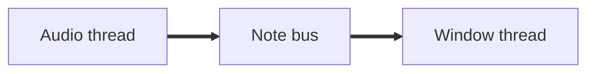

<!--
Read CONTRIBUTING.md and docs/pull-requests.md before you fill this in.

Every section below is required. The "PR description" check reads this description and fails until each section
has words of your own in it, and it names what is missing in a comment on this pull request. The text inside these
comment markers is guidance and the check ignores it. Do not delete the headings.

Write plain sentences (docs/writing-style.md). Say what the change does and why, once.
-->

## Overview

<!--
What changes and why, in a few sentences. Who notices it and how? "Closes #123" if it closes an issue.
If this changes NoteEvent, PlayerState, GameContext or the Game trait, say so here: the game engine depends on them.
-->

## Details

<!--
How it works. Name the files and functions a reviewer should read first. Say what you weighed and rejected when the
choice is not obvious. When data moves between threads or crates, draw it:

-->

## Test coverage

<!--
The tests this change adds or changes, by name, and what each one would catch if the change were broken.
Say that each new test failed with the change reverted. Say which layers of docs/testing.md you ran.
A change to Rust code adds a test. If it genuinely cannot have one, start a line with "No new test:" and say why.
-->

## Evidence

<!--
A video of the release build doing what the Overview says. Record it with:
  pwsh tools/record-evidence.ps1                 (replays a fixture)
  pwsh tools/record-evidence.ps1 -Live           (play your guitar while it records)
then drag the .mp4 into this box. GitHub uploads it and puts a link here. Add the summary.txt lines it printed.
For a change nobody can see, still record the app running, and add the command you ran and what it printed.
-->

## Performance

<!--
The numbers, with the machine and the command for each:
- Any change to crates/riffology-input or crates/riffology-core: the line printed by
  cargo test --release -p riffology-input --test latency -- --ignored --nocapture
- A change to the model library: the onset F1 lines printed by tests/replay_accuracy.rs.
- A change to drawing: frames drawn and the largest block time from the evidence summary.
If the change cannot affect timing (documentation only), write "No timing change:" and why.
-->

## Platforms

<!-- Tick every platform you built and ran this change on. At least one is required. -->

- [ ] Windows
- [ ] macOS
- [ ] Linux

## AI disclosure

<!--
Which coding agent and model you used and for what, for example "Claude Code wrote the first draft of the chart
loader; I rewrote the error handling and the tests". "None" if you used none.
-->

## Checklist

<!-- Tick each one. A box left empty fails the check. -->

- [ ] I read CONTRIBUTING.md and AGENTS.md.
- [ ] `pwsh tools/validate.ps1` passes (fmt, clippy, tests with the real model library, documentation check).
- [ ] Every new test failed with my change reverted.
- [ ] The video under Evidence shows the release build doing what the Overview says.
- [ ] Nothing on the audio thread allocates, locks or touches a file.
- [ ] The pages in docs/ that describe what I changed are updated, and follow docs/writing-style.md.
- [ ] I submit this change under the same terms as the rest of Riffology: MIT or Apache 2.0, at the user's option.
