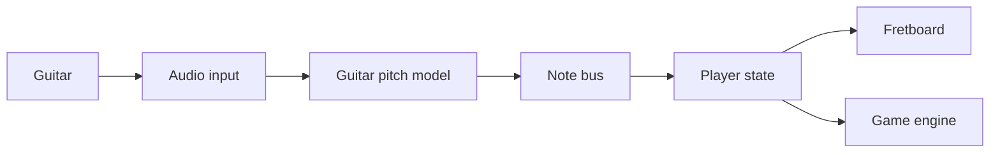

# Riffology

**A guitar game you play with a real guitar.** Plug a guitar into your computer and play. Riffology hears every
note with a polyphonic guitar pitch model, lights it on a fretboard, and tells the game exactly what you played and
when you started it.

[Getting started](docs/getting-started.md) · [Architecture](docs/architecture.md) · [The note API](docs/note-api.md) ·
[Contributing](CONTRIBUTING.md) · [All documentation](docs/README.md)



## What it does today

- **Hears what you play.** The guitar pitch model from Chordical's MIDI Guitar runs on every 10 ms of input and
  reports note ons and note offs, chords included. On the GuitarSet test fixtures Riffology's live path scores the
  same onset F1 as the model on its own: 0.885, 0.947 and 0.938.
- **Adds almost no delay.** Riffology's own code adds 3.1 ms median and 5.8 ms at the 95th percentile on top of the
  model's decision, measured on a machine with other work running ([Latency](docs/latency.md)).
- **Lights the fretboard.** Each heard note is placed on the string and fret it is most likely played on and drawn
  on a fretboard in the Black Rainbow Labs rux themes.
- **Tells the game what you played.** Every note carries its onset on the audio clock, so a game judges timing by
  when you started the note. The model's detection delay is not held against you ([The note API](docs/note-api.md)).
- **Plays against a chart.** Charts are JSON or a Standard MIDI File ([Chart format](docs/chart-format.md)).
- **Works without a guitar.** `--replay` plays a WAV file through the same path in real time, and MIDI input works
  for a MIDI guitar or a keyboard.

The game engine (the note highway, scoring, song selection) is the next part to build, and it starts from the
`Game` trait in `crates/riffology-game`.

## Run it

Windows or macOS on Apple silicon, with Rust 1.95 or newer:

```powershell
pwsh tools/fetch-guitar-abi.ps1          # downloads the guitar model library and checks its SHA-256
                                         # on macOS: sh tools/fetch-guitar-abi.sh
cargo run --release -p riffology-app     # opens the window on the default audio input
cargo run --release -p riffology-app -- --replay tests/fixtures/guitar/05_Rock1-130-A_solo.48k.wav
```

`cargo run --release -p riffology-app -- --help` lists every option.

## The guitar model

The model is not in this repository. It is published as a prebuilt library, `chordical_guitar_abi`, on this
repository's [releases](https://github.com/Black-Rainbow-Labs/riffology/releases), and `tools/guitar-abi.json` pins
the exact file by SHA-256. [The guitar model library](docs/guitar-model.md) explains how it is loaded, updated and
licensed.

## License

Riffology's code is MIT or Apache 2.0, at your option. The guitar model library has its own terms; see
[The guitar model library](docs/guitar-model.md). The test fixtures are excerpts of GuitarSet, CC BY 4.0
([tests/fixtures/README.md](tests/fixtures/README.md)).
