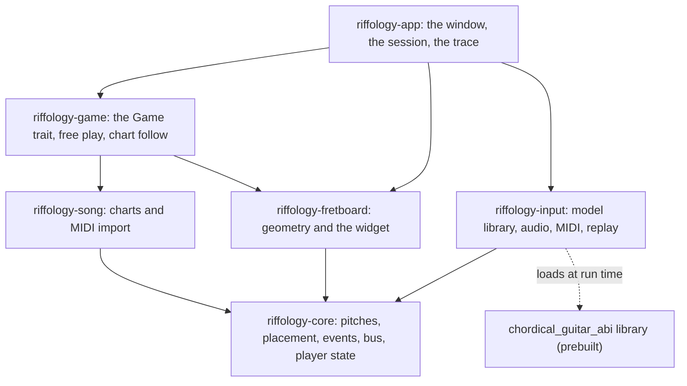
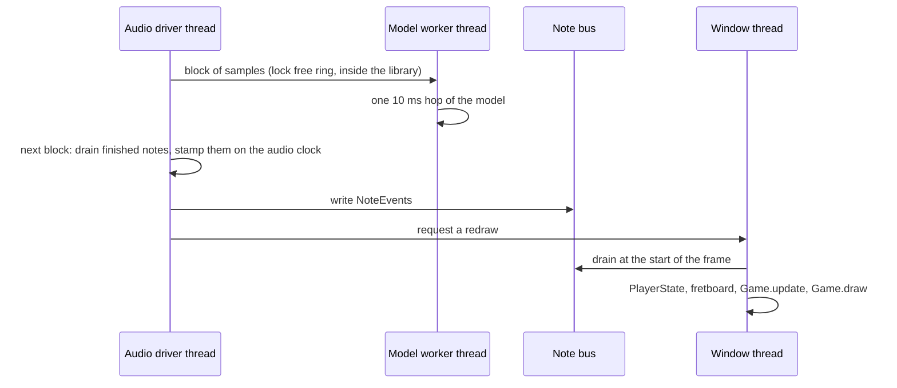

# Architecture

This page shows the crates, the threads, and the path one note takes from the guitar string to the screen. Read it
before changing anything in `crates/`.

## The crates

| Crate | Owns | Must not |
|---|---|---|
| `riffology-core` | MIDI pitches and note names, tunings, string placement, `NoteEvent`, the note bus, `PlayerState` | Touch audio devices, files or the screen |
| `riffology-input` | Loading and checking the model library, the tracker handle, the per block pipeline, cpal input, midir input, WAV replay | Draw anything |
| `riffology-fretboard` | Where each string and fret is, and drawing the board with rux | Know about songs or games |
| `riffology-song` | Charts, JSON load and save, MIDI import | Know about inputs |
| `riffology-game` | The `Game` trait and the two example games | Read inputs directly: it reads `PlayerState` |
| `riffology-app` | The window, the session that owns the inputs, the readout, `--trace` | Hold game rules |

## The threads

- **Audio driver thread.** cpal calls `InputPipeline::process` with each block. `process` pushes the samples into the
  library, drains finished notes, stamps them, and writes them to the note bus. It never allocates or locks; a test
  counts allocations to prove it ([Testing](testing.md)).
- **Model worker thread.** Inside the library. It runs the model one 10 ms hop at a time at audio priority.
- **Window thread.** eframe's thread. Each frame it drains the bus into `PlayerState`, places the sounding notes on
  strings, updates the game, and draws.
- **Replay thread.** With `--replay` it stands in for the driver thread at the same priority and sends each block at
  the moment its last sample would have been recorded.

## One note, from string to screen

| Step | Where | Time it takes |
|---|---|---|
| The pick attack reaches the labeled onset | the guitar | about 20 ms (GuitarSet labels sit after the attack) |
| The driver hands over the block | the audio interface and driver | one block, 2.7 ms at 128 samples, more on WASAPI |
| The model decides the note | `chordical_guitar_abi` worker | about 17.5 ms median after the onset on acoustic guitar, 30 ms on direct input electric |
| Riffology delivers it to the window thread | `InputPipeline`, note bus | 3.1 ms median, 5.8 ms 95th percentile |
| The window draws it | the next frame | up to one frame, 16.7 ms at 60 Hz |

[Latency](latency.md) has the measurements and how each one was taken.

## Two clocks, one meaning

Every `NoteEvent` has `onset_s` and `heard_s`, both on the audio clock. A game compares `onset_s` with the chart time,
so the model's delay is not held against the player. The window thread reads the clock from the pipeline's sample
counter, so a game's song position and the notes it judges are on the same clock. [The note API](note-api.md) has
the details.

## Where to go next

[The note API](note-api.md) for the game engine. [The guitar model library](guitar-model.md) for how the model is
loaded.
