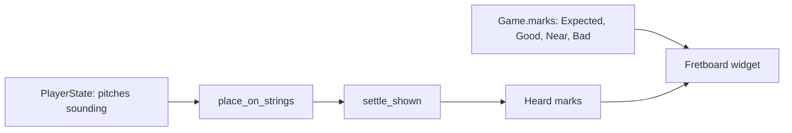

# The fretboard

The fretboard shows what the player is playing and what the game expects. This page covers how heard pitches are
placed on strings, the geometry, and the marks. The code is ported from Chordical Sheet Music's fretboard.

## From pitches to cells



The model hears pitches, so the fretboard chooses where each one is played:

1. **`place_on_strings`** takes the highest pitch first and puts it on the free string where its fret is lowest,
   then the next pitch on another free string, and so on. An open C chord (C3 E3 G3 C4 E4) lands on fret 3 of
   string 5, fret 2 of string 4, string 3 open, fret 1 of string 2 and string 1 open.
2. **`settle_shown`** holds back a new strum for one update. The model often hears only some strings of a strum on
   its first hop, and those placed alone land somewhere else. So a set that shares no pitch with what is shown waits
   one update, and the next set is shown whatever it is. Silence is shown at once.

A chart's notes carry their own string and fret, so expected notes are drawn where the chart says.

## Geometry

String 1 (the highest) is the top row, as in tab. Column 0 is the open string, left of the nut, at 70% of a fret's
width. Frets 1 to 15 (12 to 24 with `Fretboard::frets`) have equal width. `FretGeometry::cell(string, fret)` is the
rectangle of a cell and `FretGeometry::hit(point)` is the cell under a point. Neither uses egui's drawing, so both are
tested without a window.

## Marks

| `MarkKind` | Drawn as | Color in the rux theme |
|---|---|---|
| `Heard` | A filled dot with the note name | `accent.blue` |
| `Expected` | A ring | `accent.violet` |
| `Good` | A filled dot | `semantic.success` |
| `Near` | A filled dot | `semantic.warning` |
| `Bad` | A filled dot | `semantic.danger` |

Inlay dots on frets 3, 5, 7, 9, 12, 15, 17, 19, 21 and 24 use `ink.i200`. Every color comes from the theme, so the
board follows `dark-neumorphic` and `light-neumorphic`. Do not add a literal color.

## Using it

```rust
let marks: Vec<FretMark> = game.marks().into_iter().chain(player.frets().iter().map(FretMark::heard)).collect();
let board = Fretboard::new(&tuning, &marks).frets(15);
let out = board.show(rux, rect);       // out.drawn: each mark with its rectangle; out.pressed: a clicked cell
```

`out.drawn` is what `--trace` records, and the end to end test checks it.

## Where to go next

[The note API](note-api.md) for `PlayerState`. [Chart format](chart-format.md) for expected notes.
