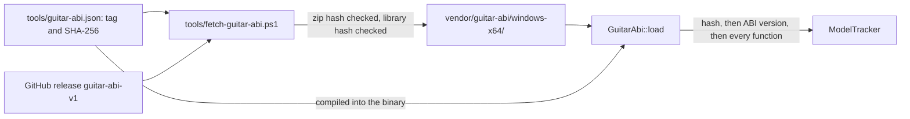

# The guitar model library

The guitar pitch model is not in this repository, and neither is its source. It reaches Riffology as a prebuilt
library, `chordical_guitar_abi`, built from Chordical's MIDI Guitar tracker and published on this repository's
releases. This page says how the library is fetched, checked, loaded and updated, and what its license questions are.

## How it is fetched and checked



`tools/guitar-abi.json` names the release tag, the zip, and the SHA-256 of both the zip and the library.
`GuitarAbi::load` looks for the library in this order:

1. the path in `RIFFOLOGY_GUITAR_ABI`
2. `vendor/guitar-abi/<platform>/` of the checkout the binary was built from
3. the folder of the running program

It refuses a file whose SHA-256 differs from the pin, a library whose `cg_abi_version` is not 1, and a library missing
any function. Each refusal says what to do. `RIFFOLOGY_GUITAR_ABI_UNCHECKED=1` skips the hash check, for trying a new
library before it is published. Never set it in CI.

The library is loaded once and never unloaded. The model's runtime keeps a thread pool inside the library after
every tracker is freed, and unloading the library would unmap code those threads run.

## What is in the zip

| File | What it is |
|---|---|
| `chordical_guitar_abi.dll` | The tracker and the model `r2-final-s2` compiled in |
| `chordical_guitar_abi.h` | The C declarations |
| `MODEL-ATTRIBUTION.md` | The model's training data and its licenses |
| `SHA256SUMS` | Hashes of the library and the header |

## The C ABI

```c
uint32_t   cg_abi_version(void);
const char *cg_model_info(void);    /* JSON: model run, SHA-256, sample rate, MIDI range */
CgTracker *cg_tracker_new(double host_rate, uint8_t sync, char *err, size_t err_len);
uint8_t    cg_tracker_push(CgTracker *t, const float *mono, size_t len);
size_t     cg_tracker_drain(CgTracker *t, CgNote *out, size_t cap);
uint8_t    cg_tracker_set_settings(CgTracker *t, float gain_db, float gate_db, float sensitivity);
uint8_t    cg_tracker_reset(CgTracker *t);
uint8_t    cg_tracker_telemetry(CgTracker *t, CgTelemetry *out);
void       cg_tracker_free(CgTracker *t);
```

`crates/riffology-input/src/abi.rs` declares the same structs in Rust and `ModelTracker` wraps them. `push` and
`drain` never block or allocate. `sync = 1` runs the model inside `push` so every run gives the same notes; the live
input uses `sync = 0`, which runs it on a worker thread at audio priority.

## The tracker settings

| Setting | Range | Default | What it does |
|---|---|---|---|
| Input gain | -24 to +24 dB | 0 dB | Gain before the model |
| Gate | -80 to -20 dBFS | -55 dBFS | Under this input level (RMS over 50 ms) no note starts |
| Sensitivity | 0.5 to 0.9 | 0.7 | The note start threshold. Lower starts notes earlier and finds more false notes |

## Updating the model

The library is built in the private repository that holds the tracker. A new model with the same inputs and outputs
needs no change to Riffology's code:

1. In that repository: `pwsh rust/scripts/package-guitar-abi.ps1 -Publish -Tag guitar-abi-v2`. It builds the
   release library, zips it, and uploads the zip to this repository's release `guitar-abi-v2`.
2. Here: change `tag`, `zip`, `zipSha256` and `sha256` in `tools/guitar-abi.json` to the values the script printed.
3. Run `pwsh tools/fetch-guitar-abi.ps1` and the test suite. `crates/riffology-input/tests/replay_accuracy.rs`
   prints the new onset F1 on each fixture. Put those numbers in the pull request.

A change to a struct or a function signature raises the ABI version, and Riffology's `ABI_VERSION` and
`abi.rs` change with it in the same pull request.

## Platforms

| Platform | Library | Status |
|---|---|---|
| Windows x64 | `chordical_guitar_abi.dll` | Published |
| macOS arm64 | `libchordical_guitar_abi.dylib` | The loader supports it. The library has to be built on a Mac and published with `-Tag` and a `macos-arm64` entry in `tools/guitar-abi.json` |
| Linux x64 | `libchordical_guitar_abi.so` | The loader supports it. Not built yet |

## License

The library's code belongs to Black Rainbow Labs and is distributed only as this binary. The model was trained on
GuitarSet (CC BY 4.0) and the GAPS v1.1 training split. GAPS is MIT on its Hugging Face card and `CC BY-NC-SA 4.0` on
its Zenodo record. That question must be settled before Riffology is sold with this model.
`MODEL-ATTRIBUTION.md` in the zip has the citations.
