# Latency

A rhythm game is judged by how soon a played note appears and how fairly its timing is scored. This page lists every
source of delay from the pick to the screen, the budget for each, and what has been measured.

## From pick to pixel

```mermaid
flowchart LR
    A["Pick attack"] -->|"about 20 ms to the labeled onset"| B["Onset"]
    B -->|"driver block, 2.7 ms or more"| C["Block reaches Riffology"]
    C -->|"model decides, 17.5 ms median"| D["Note known"]
    D -->|"Riffology, 3.1 ms median"| E["Window thread has it"]
    E -->|"up to one frame, 16.7 ms"| F["Drawn"]
```



| Stage | Owner | Budget | Measured | How |
|---|---|---|---|---|
| Model decision after the onset, acoustic guitar | model | none set here | about 17.5 ms median | Chordical's MIDI Guitar measurements on GuitarSet |
| Model decision, direct input electric guitar | model | none set here | about 30 ms | same |
| Riffology's added delay | `InputPipeline`, note bus | median 6 ms, 95th percentile 10 ms | 3.08 ms median, 5.84 ms 95th percentile, 8.48 ms 99th percentile | `tests/latency.rs`, below |
| Audio thread time per block in Riffology's code | `InputPipeline::process` | well under one block (2.7 ms) | largest block 0.13 and 0.15 ms in two runs; 14.25 ms in a third, one block while ffmpeg encoded the screen and a Blender render ran | the `max_block_ms` of the evidence traces. The time is wall time, so it includes the thread being descheduled |
| Model time per hop | worker thread | 3 ms 99th percentile | 4.2 ms 99th percentile while another job used 14 cores | the app readout |
| Frame | window | one frame | 1,547 frames in a 10.6 s replay (about 145 per second) | the end to end trace |

Detection delay is not held against the player: a game judges timing by `onset_s` ([The note API](note-api.md)).
What the player feels is the time until the note is drawn and heard.

## The added delay test

```powershell
cargo test --release -p riffology-input --test latency -- --ignored --nocapture
```

Each fixture runs twice. In sync mode the model decides each note inside the push of a block, so the note's `heard_s`
is the end of the block whose audio decided it. In real time the model runs on its worker and a reader thread polls
the note bus every 0.25 ms, recording when each note arrives. The difference per note is Riffology's added delay:
the worker's hop, the wait for the next block's drain, and the note bus.

Measured 2026-11-16 on the development PC (Intel Core Ultra 9 285, Windows 11) while a Blender render used about 9
cores and a Python job about 5:

```text
added delay over 118 of 118 notes: median 3.08 ms, p95 5.84 ms, p99 8.48 ms, largest 58.87 ms
```

The test is `#[ignore]` because it times real threads. Run it on a quiet machine and put its line in the pull
request of any change to `riffology-input` or `riffology-core`.

The first run of this test, before the replay thread took audio priority, measured 10.3 ms median and 58.5 ms at
the 99th percentile on the same busy machine. A real audio driver calls its callback at high priority, so the replay
thread now does too.

## Rules that keep it low

- The audio thread never allocates, locks or does I/O. `tests/no_alloc.rs` counts allocations on that thread over
  750 blocks and requires 0.
- A note reaches the window thread through a lock free ring and wakes it with `request_repaint`, so the window
  draws the note at its next frame.
- The model library raises its worker to the Pro Audio MMCSS class and opts it out of power throttling.

## Where to go next

[Testing](testing.md) lists every test. [Pull requests](pull-requests.md) says which numbers a pull request reports.
