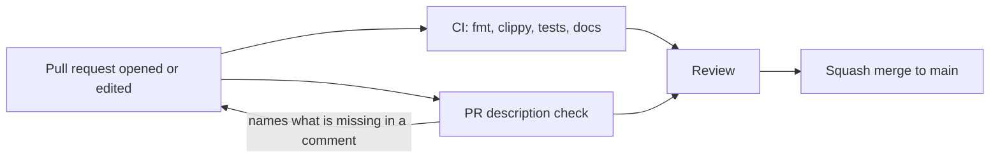

# Pull requests

Every change reaches `main` through a pull request, and every pull request proves the change works. This page says
what a pull request contains and what checks it.

## What a pull request contains

| Section of the template | What goes in it |
|---|---|
| Overview | What changes and why, in a few sentences. The issue it closes |
| Details | How it works. The files and functions to read first. A mermaid diagram when data moves between threads or crates |
| Test coverage | The tests added or changed, by name, and what each one would catch. That each new test failed with the change reverted |
| Evidence | A video of the release build doing what the overview says, from `tools/record-evidence.ps1`, dragged into the description |
| Performance | The numbers: the latency test line for any change to `riffology-input` or `riffology-core`, the onset F1 lines for a model change, frame rate for a drawing change. Machine and command for each |
| Platforms | The platforms you built and ran it on |
| AI disclosure | Which coding agent and model helped, and with what. "None" if none |
| Checklist | Every box ticked |

The template is `.github/pull_request_template.md`. GitHub fills it in when you open a pull request.

## What checks it

- **PR description** (`.github/workflows/pull-request-description.yml`) runs `.github/scripts/check-pull-request.mjs`.
  It fails until every section has words of your own, the Evidence section links a video (`.mp4`, `.mov`, `.webm` or
  a GitHub attachment), the Performance section has a number with a unit when `crates/` changed, a platform is
  ticked, and every checklist box is ticked. It posts one comment listing what is missing and updates it on each
  edit.
- **CI** (`.github/workflows/ci.yml`) on Windows: `cargo fmt --check`, `cargo clippy -D warnings`, layers 1 to 3 of
  [Testing](testing.md) with the real model library, and the documentation check.
- **Review.** The code owner reviews. A pull request merges when both checks pass and the review approves it.

## Size and scope

- One change per pull request. A refactor and a feature are two pull requests.
- A pull request that changes what a user sees updates the pages in `docs/` that describe it, in the same pull
  request.
- A change to the note API (`NoteEvent`, `PlayerState`, `Game`) says so in its Overview, because the game engine
  depends on it.

## Commits

Write the subject as what the commit does, in the present tense: "Light open strings on the fretboard". The body says
why, in plain sentences. No ticket numbers and no credit lines for tools. Pull requests are squash merged, so the
pull request title becomes the commit subject on `main`.

## Where to go next

[Writing style](writing-style.md) for how to write the description. [Testing](testing.md) for the tests.
