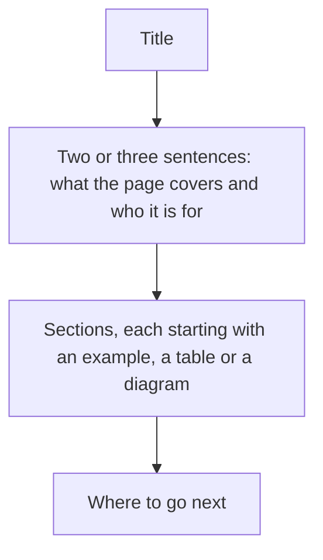

# Writing style

This page is the style guide for every page in `docs/`, the README, code comments, commit messages and pull request
descriptions. Read it before you write any of them. Agents read it too: `AGENTS.md` points here.

The reader is a programmer who knows Rust and may not know audio or music. Write for that reader.

## The rules

1. **Short declarative sentences.** One idea per sentence. If two clauses are joined by a dash, a semicolon or
   "which", split them into two sentences.
2. **Plain words.** "write", "show", "use". The common word every time.
3. **Name the thing every time.** Write "`PlayerState::started_since` returns note ons", and in the next sentence
   write `PlayerState::started_since` again. Do not write "it", "this" or "the function" when the reader could lose
   track.
4. **Say what is true and stop.** No contrast clause added for emphasis.
5. **Explain a term the first time a page uses it**, or link it to [the glossary](glossary.md).
6. **Show, then explain.** Put the command, the code or the diagram near the top of a section, then describe it.
7. **Every number has a source.** A number is printed by a test or a tool in this repository, or recorded in
   [Latency](latency.md) with the machine, the command and the date.
8. **Present tense, about the code as it is.** History belongs in git.
9. **American spelling.** color, behavior, center, gray, analyze.

## What not to write

`node tools/doc-style/check.mjs` fails when one of these appears in a page.

<!-- doc-style: off -->

| Do not write | Write instead |
|---|---|
| An em dash or an en dash | Two sentences |
| Words joined by a hyphen, like "low-latency" or "real-time" | "low latency", "real time" |
| "X, not Y" or "X rather than Y" when Y is only there for contrast | "X" |
| "load bearing", "first class", "battle tested", "blazing fast" | What the thing does, with a number |
| "worth noting", "to be clear", "honestly", "simply put" | Delete the announcement |
| "the whole point" | The reason, once |
| "the shape of", "surface" as a verb, "vocabulary" | The concrete noun: "the list of fields", "show" |
| "blows up", "kills", "takes down" for a failure | What happens: "the stream stops and the status line says so" |
| An idiom or a metaphor | The fact it stands for |

<!-- doc-style: on -->

A hyphen is fine inside a name somebody else chose and inside backticks: `riffology-core`, `r2-final-s2`, `--replay`.

## How a page is laid out

- **Diagrams** are mermaid, under about twelve boxes, with plain words in every box.
- **Tables** for anything a reader looks up: options, fields, tests, measurements.
- **Code blocks** can be copied and run as written.

## Code comments

Every function has a doc comment that says what it does and why, with `@param` lines for its parameters. Every file
starts with a module comment saying what the file is for. Update the comment when the behavior changes.

## Keeping pages correct

`node tools/doc-style/check.mjs` checks the banned phrases, that every page in `docs/` is in
[the index](README.md), and that every relative link points at a file that exists. It cannot tell whether a sentence
is still true. That is the job of whoever changes the code, in the same pull request.
